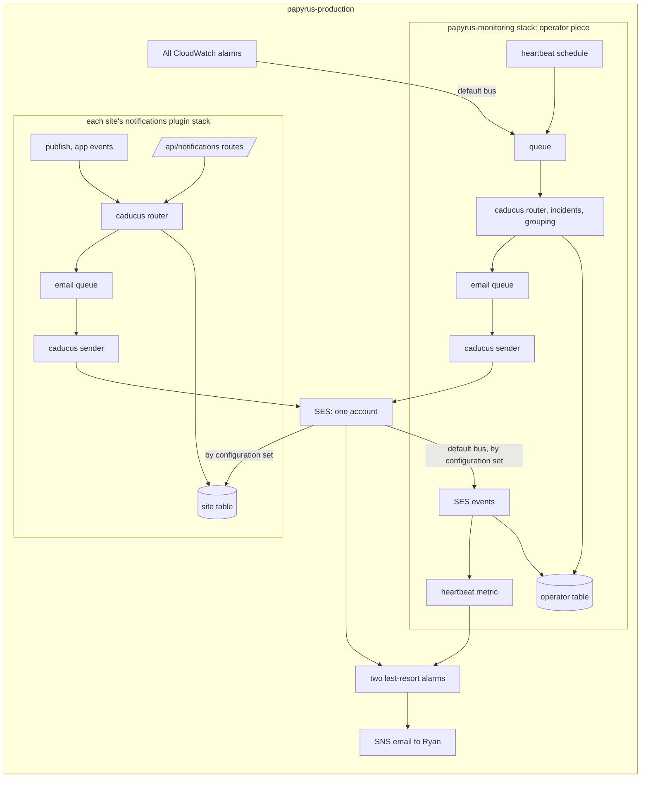

# Notifications: architecture and plan

Status: planned, reworked 2026-11-04 after Ryan reversed the first design. Nothing is deployed. Initiative `kanbus-90737c`; Papyrus side `PPY-4d1143`.

Caducus decides what deserves your attention and gets it to you. The log radar stays as one part and connects later as a source of incidents. CloudWatch alarms come first, because too many alarm emails are the same as none.

## The shape

No new AWS account and no central service. Caducus is a Python package that runs inside each deployment. Nothing is shared at runtime.



| Where | What |
| --- | --- |
| Package `caducus`, extra `notify` | Event format, base kinds, routing, incidents, grouping, preferences, consent, suppression, delivery log, channels, tokens, SES-event handling, handlers. Stores and mailers are interfaces. No AWS account, CDK or deploy in this repo |
| Papyrus plugin `notifications` | Per-site table, key, queues, functions, routes and pages. Model: `amplify/plugins/newsletter/` |
| Operator piece in `papyrus-monitoring` | One listener for the whole account, because these alarms belong to no one site and listening per site would send one email per site |
| Other apps, later | The same package in their own deployments and accounts |

**Package.** Published to PyPI from this repo when `main` changes, like other Anthus packages. Hosts pin an exact version. Lambdas take the wheel plus the runtime's boto3; `PyYAML` and `virtuus` move to a `radar` extra so the radar's dependencies stay out. Python, because Caducus and the code worth reusing are Python. Today publishing does not work: PyPI holds only 0.1.0 and the release job last failed (`kanbus-9cc7ec`).

**Operator piece** (`PPY-e92c8e`). In `infra/monitoring/papyrus-monitoring.yaml`, zip from `infra/monitoring/build.py --operator`. A rule on the account's default bus takes every `CloudWatch Alarm State Change`, with or without alarm actions: no forwarder, no cross-account anything. A scheduled reconcile with `describe-alarms` opens incidents for what is already firing and catches lost events. Papyrus's alarm catalog lives in Papyrus, not here. Operators come from the stack's existing mailbox parameter for now.

**Site piece.** Table, KMS key, queues and functions per site, as with the newsletter. The site's CMS routes invoke the site's own function, and `publish_alerts.py` invokes it asynchronously on a real publish, so there is no event bus or network API. Readers, subscriptions and consent live in that site's table.

**SES.** papyrus-production has production access. No new identity per site: a site uses the identity and configuration set `papyrus-<site>` from the newsletter's sending stack, so one reputation and one pause per site. The newsletter handler already ignores events with no `sub` tag. Anth.us and Threat Intelligence have no identity yet and get the same stack. Operator mail: `notify.anth.us`, same stack, set `papyrus-operators`. The anth.us zone is in this account, so no delegation and no collision found. Open and click events are never enabled, and a test fails if they appear.

**Brand.** A site's `theme` in `papyrus.config.ts` is validated at synth and reaches the function as `THEME_JSON`, as the newsletter's does. The package takes a renderer: Papyrus passes `email_render`, which has Markus in its bundle. Operator mail uses the package's plain template and neutral brand. A shared renderer waits until a second app wants branded public mail.

**Other apps.** Same package, one operator listener per AWS account, their own catalog, table, SES identity and last-resort alerts. Their SES accounts read as sandbox on 2026-11-04, which is enough for verified operators; production access is their own request when they mail customers.

## What this gives up

- **Independence from account problems.** Operator mail shares an AWS account and an SES reputation with every site, the newsletter and Prospectus. Trouble with the account takes alerts down with what they report on.
- **One view across sites.** No cross-site subscriber list or history. A person who administers two sites has two sets of choices. Each host's delivery log is its own.
- **Shared capacity with no coordination.** 14 a second and 50,000 a day on the 2026-11-04 reading, across all senders. Each pacer reads `MaxSendRate` and can't see the others, so throttling backoff does the rest.
- **Fast upgrades.** A package change means a Caducus release, then a Papyrus release and a site batch, or a hand-run change set on `papyrus-monitoring`.
- **One-app ease on Slack and Discord.** A Slack app has one Events URL, and no central endpoint exists. So no inbound events: uninstall shows at the next send.

It gains: no account to run, no SES request, no bus policy or API auth, and each site's data staying with the site.

## The last-resort alerts

Exactly two human alerts stay on SNS, in papyrus-production, on the existing `papyrus-monitoring-alarms` topic, whose subscription is already confirmed.

1. **SES in trouble.** `Reputation.BounceRate` >= 5%, `Reputation.ComplaintRate` >= 0.1%, the lines SES recommends, or a refused heartbeat send, since SES documents no account-paused event. Account-wide, so it covers sites and Prospectus too.
2. **Dead-man's switch.** Every 15 minutes a heartbeat runs the real path: queue, router, email queue, SES to the mailbox simulator, delivery event on the default bus, handler, metric. An alarm with missing data as breaching fires after three missed periods.

In the same account this catches a broken Lambda, queue, IAM change, bad package release, EventBridge rule or SES refusal, because CloudWatch alarms and SNS do not depend on any of them. It cannot catch account suspension, a Region-wide CloudWatch or SNS failure, or Ryan's mailbox, because nothing outside the account is watching. Site plugin stacks are not on the heartbeat; their dead-letter and error alarms reach the operator listener.

The newsletter's bounce and complaint alarms pause sending through an SNS action (`src/papyrus_content/newsletter/events.py`). That is machine use, and it moves to an EventBridge rule (`PPY-819117`) before those actions are removed; the human-alarm cleanup (`PPY-f66e91`) leaves it alone.

## Event format and data

Same shape whichever way a host delivers it:

```json
{"schema": 1, "eventId": "idempotency key", "kind": "story.published", "product": "papyrus", "site": "shipped",
 "occurredAt": "2026-11-04T12:00:00Z", "severity": "info", "groupKey": "optional",
 "facts": {"title": "...", "summary": "...", "url": "..."}}
```

Apps name a kind, never recipients; only account mail may name one Person. Base kinds ship in the wheel; a host adds its own.

One DynamoDB table per host, keys `pk`, `sk`, TTL `expiresAt`, customer-managed KMS key, point-in-time recovery off so erasure is real:

| pk / sk | Holds |
| --- | --- |
| `EVENT#id` / `META` | The event; dedupe by conditional put |
| `EVENT#id` / `DELIVERY#id` | **The delivery log**; GSI `byRecipient` |
| `INCIDENT#...` / `STATE` | Open or cleared, times, flaps, acknowledgement |
| `GROUP#key` / `OPEN` | Events waiting for one grouped message |
| `RCPT#key` / `CONTACT#channel`, `PREF#scope`, `CONSENT#kind`, `SUB#list` | Address or channel id, choices, consent evidence, subscriptions |
| `SUPP#hash` / `SUPP` | Suppression, holding no address |
| `CONN#platform#id` / `CONN` | Slack or Discord connection, token encrypted with KMS |

Delivery log fields: `deliveryId`, `eventId`, `kind`, `class`, `product`, `site`, `recipientKey`, `channel`, `destinationMask`, `status`, `reason`, `providerMessageId`, `attempts`, `groupId`, `incidentKey`, `queuedAt`, `sentAt`, `finalAt`, `ackRequested`, `ackAt`, `expiresAt`. A status never moves backward, since SES events can arrive out of order. "Why not" is recorded too: `skipped_preference`, `suppressed`, `grouped`, `refused`, `dead_lettered`. Retention 90 days. Addresses are never logged.

People: `PERSON#id` for account members, `SUBJECT#ss1_...` for a signed-in reader, `ADDR#hmac` for an email-only subscriber. Prospectus holds no email, so the host holds addresses, confirmed by double opt-in or from the verified claim at sign-in. An admin joins the audience by signing in after launch.

## Keeping the noise down

One message per incident and one on clearing. Alarms firing together become one message listing them all. Nothing is capped or dropped: group and pace. Acknowledgement only for kinds that opt in, asked for in plain words; GET changes nothing, so a mail scanner cannot acknowledge. Alarms go only to operators; a site's own events go to its admins. A dead-letter queue is just another alarm, whose message names the command to redrive.

## Secrets and channels

Generated secrets: SSM SecureString, created once by IaC. Per-install Slack and Discord tokens are created at runtime, so they are KMS-encrypted in the site's table. App credentials issued by Slack and Discord are typed by Ryan, through a script, into shared `/papyrus/shared/*` parameters. Titles and reader text are escaped so a headline cannot ping anyone (Slack: escape `& < >`; Discord: `allowed_mentions: {"parse": []}`).

## Build order

| | Delivers | Where |
| --- | --- | --- |
| **M1** | Every alarm in papyrus-production reaches Ryan as triage-ready email, beside the SNS email | Package (`kanbus-`), operator piece (`PPY-`) |
| **M2** | Turning things off; test and history; dead letters; acknowledgement; human SNS email removed | Both |
| **M3** | Plugin, site mail, anyone can subscribe, new-story replaces alert lists, console and CLI, all sites in one batch, docs | Mostly Papyrus |
| Later | Slack, then Discord; adoption in Chatticus, Cyclotron, Babulus; rest of SNS; radar; quota; Prospectus grants | Coarse on purpose |
| Last | Weekly digest | Untouched |

## Announcements on X (broadcast)

Added 2026-11-12 for Papyrus `PPY-09ee86` (`kanbus-ea2644`). Three additions, all in the package:

- **`broadcast` recipient class.** A kind of class `broadcast` is addressed to one connected channel account, `CHANNELACCT#<channel>#<accountId>`, named in the event's `audience`. There is no person, so no preference, consent or suppression applies. The host's `Directory.account(key)` resolves the account; an unknown account, or one whose channel the kind does not list, is refused with "no audience". The post text is `facts.text` (required); `facts.url` is the link used to recognise the post later. A broadcast kind cannot group or have a lifecycle. Dedupe is the caller's `eventId`, as for every event: Papyrus sends `story.announce:<accountId>:<lineageId>`, so one delivery exists per account per Story.
- **`x` channel** (`caducus.notify.channels.x`). `send` posts the text exactly as drafted (`POST /2/tweets`, OAuth 2.0 user token); `delete(delivery, by=...)` takes it down (`DELETE /2/tweets/:id`). The host supplies a `TokenProvider` (tokens are never stored or logged here), a `PriceTable`, a `Guard` (pause and budget) and optionally a `RecentPosts` reader; the built-in one reads `GET /2/users/:id/tweets` and matches the link, else the exact text. The contract is in the module docstring.
- **Cost on deliveries.** `cost` (decimal string, a running total that only grows), `costCurrency`, `costNote` (the price list the host named, with its date). Set by the channel from the host's `PriceTable`, never guessed: X returns no price. Also `withdrawn` (the highest status), `withdrawnAt`, `withdrawnBy`.

**Exactly once.** X has no idempotency key. The delivery is claimed before the request. A timeout, a dropped connection or a 5xx is an unknown outcome: the delivery stays claimed and queued, `send` raises `UnknownOutcome`, and the queue's redelivery finds the claim, reads the account's recent posts first (priced per post returned) and records the post as sent if it is there. Only when it is not there does the post go out. A 4xx is final (`failed`, with X's message). A 429 waits until `x-rate-limit-reset` and repeats the request, since X did not process it; with no reset header it fails rather than guess. X's duplicate-content refusal counts as posted only if the read confirms it. The `Guard` is asked before every post; a pause or budget refusal records `refused` with the host's reason (the delivery is final, so the host re-announces under a new event id when it resumes). Withdrawing is never blocked by the guard.

## Public audiences

Anonymous readers who subscribe by email (double opt-in, consent evidence, lists, one-click unsubscribe, suppression, erasure, learned abuse limits) are designed in [public-audiences.md](public-audiences.md) (`kanbus-2bba4f`, Papyrus `PPY-1081ad`).

## Deliberately deferred

Digests. Phone paging (never). Generic webhook channel: designed only, an HTTPS POST of the delivery as JSON through the `Channel` interface, signed per connection, same queues, SSRF checks on the URL (`kanbus-93a4f9`). Inbound Slack and Discord events. A shared renderer or UI package. Custom domain for operator pages. An outside watcher for the dead-man's switch. Merging with the inbound Papyrus Slack agent app.

Decisions and Ryan's steps are on `kanbus-90737c` and `PPY-4d1143`.
