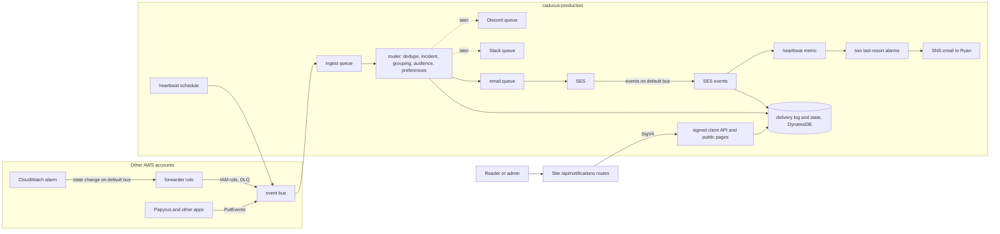

# Notifications: architecture and plan

Status: planned, nothing built. Initiative `kanbus-90737c`; Papyrus side `PPY-4d1143`. Goal, scope and decisions are in the initiative; this says how.

Caducus decides what deserves your attention and gets it to you. The log radar stays as one part and connects later as a source of incidents (`kanbus-d7b6ac`). CloudWatch alarms come first, because too many alarm emails are the same as none.

## The shape

One small central service in its own AWS account, `caducus-production`. Apps do not call a mail API: they put one JSON event on a bus. The service decides who hears about it, on which channel, and records what happened.



| Where | What |
| --- | --- |
| Central service (this repo) | Event format, kind registry, routing, incidents, grouping, preferences, consent, suppression, delivery log, channel senders, public manage pages, Slack and Discord install flows |
| Client | Almost nothing: the JSON schema and `PutEvents`. A thin Python helper, then a thin TypeScript one when Chatticus adopts. `caducus-email-render` is a shared package |
| Per app | Emits events; supplies its brand at deploy; its own console pages and CLI, which call the signed API |
| Per AWS account | One forwarder stack, from a StackSet |

**Language and hosting.** Python 3.12 Lambdas on arm64, with SQS between steps, DynamoDB, EventBridge and CDK in Python. Caducus is already Python, and the code worth reusing (newsletter sender, tokens, email renderer) is Python, so one language runs through the repo. The load is small and bursty, which suits Lambda with no idle cost. DynamoDB rather than the Virtuus files the radar CLI uses, because this needs TTL for retention, conditional writes for dedupe, and an index by recipient. CI in GitHub Actions; CD by OIDC on merge to main; no stored keys.

**Account.** A new AWS account keeps delivery reachable when a product account is broken, and keeps reader data out of the product accounts. One account to start, us-east-1, no staging: the SES mailbox simulator and a site under test cover the risky parts.

**CloudWatch across accounts.** CloudWatch sends every alarm state change to its account's default bus, with or without alarm actions, and documents that delivery as guaranteed. So alarms need no change and SNS actions can simply go. Each account has one rule forwarding those events to the central bus; the bus policy allows the AWS Organizations tree by `aws:PrincipalOrgID`. A stale-source heartbeat catches a broken forwarder.

## Event format

EventBridge `source` `anthus.<product>`, `detail-type` `Notification Requested`, detail:

```json
{"schema": 1, "eventId": "idempotency key", "kind": "story.published", "product": "papyrus", "site": "shipped",
 "occurredAt": "2026-11-04T12:00:00Z", "severity": "info", "groupKey": "optional",
 "facts": {"title": "...", "summary": "...", "url": "..."}}
```

Apps name a kind, never recipients; only account mail may name one Person. `config/notification-kinds.yaml` says each kind's class (operator, admin, account, public), defaults, channels, grouping and whether it asks for acknowledgement.

## Data model

One DynamoDB table, keys `pk`, `sk`, TTL `expiresAt`, customer-managed KMS key, point-in-time recovery off so erasure is real.

| pk / sk | Holds |
| --- | --- |
| `EVENT#id` / `META` | The accepted event; dedupe by conditional put |
| `EVENT#id` / `DELIVERY#id` | **The delivery log**, below; GSI `byRecipient` |
| `INCIDENT#awsaccount#region#alarm` / `STATE` | Open or cleared, times, flap count, acknowledgement |
| `GROUP#key` / `OPEN` | Events waiting for one grouped message |
| `RCPT#key` / `PROFILE`, `CONTACT#channel`, `PREF#scope`, `CONSENT#kind`, `SUB#site#list` | The person's address or channel id, choices, consent evidence, subscriptions |
| `SUPP#hash` / `SUPP` | Suppression, holding no address |
| `BRAND#id` / `BRAND` | One brand per product or site, from the newsletter's theme fields |
| `CONN#site#platform#id` / `CONN` | Slack or Discord connection, token encrypted with KMS |

**Delivery log** (`schemas/delivery-log.v1.json`, `kanbus-53a88d`): `deliveryId`, `eventId`, `kind`, `class`, `product`, `site`, `recipientKey`, `channel`, `destinationMask`, `status`, `reason`, `providerMessageId`, `attempts`, `groupId`, `incidentKey`, `queuedAt`, `sentAt`, `finalAt`, `ackRequested`, `ackAt`, `expiresAt`. A status never moves backward, since SES events can arrive out of order. "Why not" is recorded too: `skipped_preference`, `suppressed`, `grouped`, `refused`, `dead_lettered`. Addresses are never logged.

**People.** A recipient is `PERSON#id` for account members, `SUBJECT#product#ss1_...` for a signed-in reader, `ADDR#site#hmac` for an email-only subscriber. Readers' pairwise subjects cannot be linked across sites, on purpose, so a reader's choices are per site. Prospectus holds no email, so the service holds addresses: confirmed by double opt-in, or the verified claim sent by the app at sign-in. Until Prospectus adds a machine route (`kanbus-3e30d1`), the operator list is SSM, and an admin joins the audience by signing in after launch.

## What is reused

| From | Reuse |
| --- | --- |
| Papyrus `src/papyrus_content/newsletter/` | Double opt-in, tokens, claim-before-send, throttling and pacing to `MaxSendRate`, event mapping, per-set pause, erasure by index |
| Papyrus `src/papyrus_content/email_render/` | Split so Markus stays in Papyrus; the rest becomes `caducus-email-render` |
| Papyrus `infra/newsletter/papyrus-newsletter-sending.yaml` | Identity, DKIM, MAIL FROM, DMARC, configuration set without tracking |
| Papyrus `docs/newsletter.md`, `src/papyrus_content/projection/standard/newsletter_pages.py` | Clean pages for people, `/api` for machines, same-origin rules |
| Papyrus `src/papyrus_content/publish_alerts.py` | The one place a real publish is announced |
| Papyrus `amplify/plugins/newsletter/secure-string-parameter.ts` | Create-only SSM SecureString |
| Papyrus `infra/monitoring/papyrus-monitoring.yaml` and `infra/scheduled-jobs` | Alarm descriptions seed the triage catalog; their SNS email is removed in `PPY-f66e91` |
| Prospectus `docs/SECURITY.md`, `docs/accounts/PAPYRUS_SITES.md`, `docs/QUOTA.md` | Pairwise subjects, retired subjects, percent-only quota; mail-scanner rule for links in `docs/ARCHITECTURE.md` |

Papyrus connects through a `notifications` plugin (`PPY-44721a`): one block in `papyrus.config.ts`, brand sent at deploy, `/api/notifications/*` routes, projected pages. The Papyrus console's Notification Center stays review requests; a message may link to it.

## SES

- The first slice sends only to verified operators, so it needs no production access. Sandbox limits: verified recipients, 200 a day, 1 a second. Public mail waits for production access, requested early (`kanbus-20d4c2`).
- SES events go to the default bus (the only bus SES publishes to), best effort and possibly out of order. Open and Click events are never enabled, and a test fails if they appear.
- Site mail reuses each site's identity in papyrus-production by sending authorization: no DNS change. Quota, reputation and billing fall on the new account. AWS's page on delegates does not list EventBridge, so `kanbus-313b10` tests that first and has a fallback.
- Public and operator mail share one SES reputation. A per-site alarm pauses that site's configuration set well before SES would act (4% and 0.08%, as today; SES says it may pause at 10% and 0.5%). Gmail gives SES no complaint data, so complaint rates undercount.

## Keeping the noise down

One message per incident and one on clearing (`kanbus-9a3b85`). Alarms firing together become one message listing all of them (`kanbus-4eba71`). Nothing is capped or dropped: group and pace. Acknowledgement only for kinds that opt in (`kanbus-42a682`), asked for in plain words; GET changes nothing, so a mail scanner cannot acknowledge. Starting list to confirm after real use: site sending paused, and dead-letter incidents.

A dead letter becomes one operator incident naming the queue and the command to redrive, and clears when the queue is empty (`kanbus-b9f48f`). Exactly two alerts remain on SNS (`kanbus-a402b9`): SES at risk or unable to send, and a dead-man's switch whose heartbeat runs the real path through SES to the mailbox simulator.

## Secrets and channels

Generated secrets: SSM SecureString, created once by IaC. Per-install Slack and Discord tokens are created at runtime, so they are KMS-encrypted in DynamoDB. App credentials issued by Slack and Discord are the one thing typed by hand, by Ryan, through a script into IaC-created parameters. Every inbound request is signature-checked; titles and reader text are escaped so a headline cannot ping anyone (Slack: escape `& < >`; Discord: `allowed_mentions: {"parse": []}`). Uninstall stops sends and tells the admin. Details: `kanbus-ae4094`, `kanbus-2c455a`, `kanbus-f4ad82`, `kanbus-26003f`.

## Build order

| | Delivers | Epics |
| --- | --- | --- |
| **M1** | CloudWatch alarms from papyrus-production reach Ryan as triage-ready email, beside the SNS email | Core, Email, CloudWatch, last-resort part of SNS |
| **M2** | Anyone can turn things off; test and history; dead letters; acknowledgement; every AWS account; Papyrus SNS email gone | Core, CloudWatch, SNS |
| **M3** | Brand; site mail; anyone can subscribe; new-story replaces alert lists; console and CLI; all sites in one batch; docs | Brand, Settings, App, Email, Papyrus side |
| Later | Slack, then Discord; adoption in Chatticus, Cyclotron, Babulus; rest of SNS; radar; quota | Coarse on purpose |
| Last | Weekly digest | Untouched |

M1 cuts across three epics because a slice must run end to end. Issues carry labels `m1`, `m2`, `m3`, `later`, and `ryan-step`.

## Deliberately deferred

Digests. Phone paging (never). Generic webhook channel: designed only, an HTTPS POST of the delivery as JSON through the `Channel` interface, signed per connection, same queues and SSRF checks on the URL (`kanbus-93a4f9`). A shared preferences UI package, until a second app needs one. Merging with the inbound Papyrus Slack agent app. Log lines in alarm messages. Alarm-tag routing: tags can travel in the event, but name patterns work without changing any alarm. A staging account. A second SES account for operator mail.

## Ryan's decisions and steps

Current list with recommendations is on the initiative `kanbus-90737c`. His steps are the issues labelled `ryan-step`.
