# Public audiences: design

Status: built on develop 2026-11-12, not released (`kanbus-2bba4f` under epic `kanbus-e5812c`; Papyrus `PPY-1081ad`, epic `PPY-824c14`). Nothing is deployed. Specification: `features/notifications/public_audience.feature`.

A **public audience** is the set of anonymous readers of one host (one Papyrus site, one table) who asked, by email, to receive some of its mail. It sits beside the `operator`, `admin`, `account` and `broadcast` classes. It is generic: no Papyrus words, so every Anthus product can reuse it. This document is the package side; the Papyrus side (routes, pages, plugin) is `docs/plans/public-audiences.md` in AnthusAI/Papyrus.

## What it is

- **One subscriber per address per host.** The recipient key is `ADDR#<hmac>`, the same keyed hash the operator directory already uses (`recipient_key_for_address`), so a person who is both an operator and a reader of a site is one recipient there. A person on two sites is two subscribers (two tables); nothing links them.
- **Lists.** The host declares the lists a reader can choose, each `{id, kind, name, description}`: for Papyrus, new stories (kind `story.published`), the weekly issue (kind `newsletter.issue`, PPY-4108ef) and per-section lists (same kind, a different list id). A reader subscribes to lists, not kinds. An event of a public kind names the lists it is for (`lists` in the event); its audience is the union of those lists' confirmed subscribers, and each subscriber gets one delivery even when on several of them (the delivery id is a hash of event, recipient and channel).
- **Consent.** A subscription exists only after double opt-in, after a manage-link opt-in by the same inbox, or after an import that carries the original evidence (marked `migrated`).

## Lifecycle

```mermaid
stateDiagram-v2
    [*] --> pending: subscribe (form, valid, not limited)
    pending --> pending: subscribe again after the resend gap (new nonce; the old link dies)
    pending --> [*]: confirm window passes (TTL deletes the record)
    pending --> confirmed: confirm (POST, token valid, nonce current)
    confirmed --> confirmed: preferences (lists on and off, by manage link)
    confirmed --> unsubscribed: unsubscribe from everything (one click or page)
    confirmed --> suppressed: permanent bounce or complaint
    unsubscribed --> confirmed: re-subscribe by manage link, or a new double opt-in
    suppressed --> confirmed: a deliberate opt-in by manage link (bounce, complaint)
    confirmed --> erased: erasure (person or admin)
    unsubscribed --> erased
    suppressed --> erased
    erased --> pending: the person subscribes again through the form (never by import)
```



### Subscribe

`PublicAudience.subscribe(request)` with `{address, lists, consent, formId, page, origin, honeypot, ip, userAgent}`. The host has already checked that the request came from its own pages (Papyrus: same `Origin`, or same-origin `Referer`, on its `/api` routes). In order:

1. **Honeypot.** A filled hidden field: answer `check_email`, do nothing. The client-supplied render time is not used: anyone can forge it, and the 24 hour cut-off it implied in the newsletter plugin turned away real readers.
2. **Shape.** Address syntax (normalized, at most 254 characters), at least one known list, and the consent wording **exactly equal** to the host's configured wording for the form. A different wording is `400 invalid_consent`: the stored wording is then provably what the form showed, because the form reads it from the same settings (`offered` state).
3. **Network limit** (below). Over the limit: `429 slow_down`. This reveals nothing about any address, and tells a real person on a busy shared network to try later instead of waiting for mail that will not come.
4. **Cheap validity check.** The domain must accept mail: an MX record, or an A/AAAA record as the implicit MX of RFC 5321; a null MX (RFC 7505) fails. `DomainChecker` is an interface; `DnsDomainChecker` uses dnspython (in the `notify` extra) and caches per container. A domain that does not take mail is `400 invalid_email`, said to the person, because it says nothing about whether anyone subscribed.
5. **Suppressed** for bounce or complaint, or **already confirmed for every requested list**: `check_email`, nothing sent.
6. **One outstanding confirmation per address.** If a confirmation for this address is still live and younger than the **resend gap**, `check_email`, nothing sent. Otherwise a fresh nonce replaces the old one (the earlier link stops working) and one confirmation is queued.

Every valid-looking request that is not network-limited answers `202 check_email`, whatever the host knows about the address.

The pending record holds the address, the requested lists, the nonce, `requestedAt`, and the consent request (below). It expires (DynamoDB TTL) at the end of the confirm window: someone who never confirmed never consented, so their address is kept no longer than the link works.

### Confirm

The confirmation email links to the host's confirm **page**, which shows a button; the button POSTs. A GET never confirms, because mail scanners fetch links. `confirm(token, ip, userAgent)` checks the signature, purpose `confirm`, expiry and that the nonce is the profile's current one (single use: it is cleared at once). The profile becomes confirmed, the lists become subscribed, the consent record is completed with `confirmedAt`, and the answer carries a manage token for the confirmed page. Confirming lifts an `unsubscribed` or `erased` suppression, since the person asked again. A bounce or complaint suppression is never reached this way, because a suppressed address is sent no confirmation (step 5): mailing an address that bounced would risk the site's reputation. It is lifted only by a manage-link opt-in, where the person proves they read that inbox. `confirm_state(token)` is read only, for the page (list names).

### Preferences, unsubscribe, re-subscribe

- `preferences_state(token)`: the masked address (`r***@example.com`) and every list with on or off.
- `update_preferences(token, lists)`: the chosen set becomes the subscription. Turning a list on again needs no new double opt-in: the manage token proves control of the inbox. A consent record of source `manage_link` is appended, and a bounce or complaint suppression is lifted.
- `unsubscribe(token, list=None)`: one list, or everything; turning off the last list counts as everything. Everything also writes `SUPP#` with reason `unsubscribed`, so nothing of the public class reaches the key until a new opt-in. Idempotent: a repeat, or a token whose subscriber was erased, still succeeds, so a mail provider's retry is harmless.
- **RFC 8058.** Every public-class message carries `List-Unsubscribe: <one-click URL>` and `List-Unsubscribe-Post: List-Unsubscribe=One-Click`. The URL is the host's machine endpoint with the manage token and the list, never an address. The host answers that POST without an origin check (mail providers post from their servers) and calls `unsubscribe` in the same request, as RFC 8058 and Gmail's bulk-sender rules require.

### Tokens

`v1.<base64url(json)>.<base64url(hmac-sha256)>`, the newsletter plugin's proven format, verified in constant time. Claims: `k` recipient key, `p` purpose (`confirm` or `manage`), `n` nonce, `e` expiry, `g` generation. Confirm tokens expire with the confirm window and are single use. **Manage tokens never expire** (an unsubscribe link must keep working in an old email) and die with the record: `g` is the profile's creation stamp, so after erasure and a later re-subscription an old link no longer matches. The token key is HKDF-SHA256 from the host's existing recipient-key secret (SSM SecureString), info `caducus-audience-token`; the hash key stays the secret itself so recipient keys do not change.

### Suppression

`SUPP#<recipient key>` / `SUPP`, holding no address: reasons `bounce`, `complaint`, `unsubscribed`, `manual`, `erased`. Checked before queueing a delivery and again by the email channel just before sending (a reader may unsubscribe while a message waits in the queue). The host's SES event handler calls `provider_event(recipient_key, status)`: a permanent bounce or a complaint on public-class mail suppresses and unsubscribes from every list. Soft bounces only count. A `manual` suppression is never lifted by an opt-in.

### Erasure and export

- `erase(address)` (admin) and `erase_self(token)` (the person, from the preferences page): delete the profile, every subscription and consent row, every delivery row of the key (through the `byRecipient` index) and its content row, then write `SUPP#` with reason `erased`. That row holds no address. It stops an **import** from silently bringing the address back; the person can still subscribe again through the form, which is a fresh consent.
- `export(address)` (admin only): the profile, lists, every consent record with its wording text, and the delivery history, as JSON. Hosts expose it only to admins (Papyrus: admin group, checked again in the function), never through any content API.

### Import (migration)

`import_subscriber(address, lists, evidence)` for moving subscribers from another system without re-confirming (Papyrus PPY-6b2d35). The evidence is copied and marked `{"source": "migrated", "from": "<system>", ...original fields}`; no mail is sent; it is idempotent; an `erased` suppression refuses it; a bounce or complaint suppression is imported as such. `add_alias(source, old_id, address, expires_at)` writes `ALIAS#<source>#<old id>` → recipient key with a DynamoDB TTL, so a host can honour old-format links for a dated period: when the date passes the rows vanish, and the host deletes its old-link code in the same release that follows. There is no standing compatibility path.

## Abuse limits, learned from the host's own traffic

No fixed counts. Each limit comes from the data or from a real constraint.

- **Per address: one outstanding confirmation.** The resend gap is learned from how long this host's readers take to confirm. Each confirmation adds its lag (sent to confirmed) to a histogram of power-of-two second buckets on one row (`STATS#confirm-lag`, O(1) per confirm). The gap is the smallest lag that, with 95% confidence, covers 95% of confirmations: the k-th order statistic, with k the smallest index where the binomial CDF reaches 0.95. That needs at least 59 confirmations (0.95^59 < 0.05). Until then the gap is the whole confirm window: no second confirmation while the first link works. This is what stops a confirmation bomb against someone else's inbox.
- **Per network** (IPv4 /24, IPv6 /48, keyed hash, never the address). Counts of accepted subscribes per network per hour live in `RATE#network#<hash>#<hour>` rows with a two-day TTL (atomic add). One row `STATS#network` keeps two running totals: accepted requests and network-hours with at least one. Their ratio, with one pseudo-request and one pseudo-hour as the prior, is the mean μ a network sends in an hour on this host. A request is refused when, under Poisson(μ), a count this high has probability below 1 / (network-hours seen so far + 1): over the host's whole history, expected wrongful refusals stay under one. Refused requests do not count toward μ, so an attack cannot teach the limit to accept itself.
- **Per host: a surge notice, not a block.** A story can go viral, so the whole-audience rate is never refused. When the hour's count is improbable under the host's own hourly mean (same test), the host's `admin` kind `audience.surge` is raised once per hour. Mass bogus signups would show in bounces, and the site's bounce and complaint guard (below) pauses sending before the shared SES account is at risk.

Each refusal writes a structured log line and a metric (`SubscribeLimited`, dimension `Scope`), with no address.

## Sending

- **One send path.** The confirmation is an ordinary event of the base kind `audience.confirmation` (class `account`, its `audience` the recipient key), so it goes through the router, the email queue, the email channel, the delivery log and SES event handling like everything else. A public kind's event is fanned out page by page: the router records `EVENT#<id>` / `FANOUT` and queues the first page; each page (one DynamoDB query page of the `byList` index) is one message on the email queue, which queues that page's deliveries and the next page. A retry resumes from the stored cursor; deterministic delivery ids make every step idempotent. No Lambda timeout bounds the audience size.
- **Index.** One new GSI on the host table, `byList` (partition `gsiList` = list id, no sort key, keys only), written only while a subscription is confirmed and the key is not suppressed. That is the only new index in this change (Papyrus rule: at most one per table per deploy).
- **Channel.** For public-class mail the email channel re-checks subscription and suppression, adds the RFC 8058 headers, and passes the reader's manage and unsubscribe page links to the host's renderer for the footer. `Mailer.send` gains `headers`; `SesMailer` sends them as SES v2 `Simple.Headers` (boto3 1.35.8 or later).
- **Pause.** The pause switch is the SES configuration set's own sending switch, turned off by the site's bounce and complaint alarms (Papyrus PR #1427) or by an operator. There is no second flag in the table. See "The pause assumption" below.
- **Thresholds**, from the providers' published rules: SES puts an account under review at a 5% bounce rate or 0.1% complaint rate and may pause it at 10% or 0.5%; Gmail and Yahoo require bulk senders to stay under a 0.3% spam rate, with 0.1% the target. A site therefore pauses itself at 4% bounces or 0.08% complaints over 24 hours, below the account lines, so one site's bad week cannot pause the others. The newsletter plugin already uses these values.
- **No tracking.** No open or click tracking, no pixel, no rewritten link (the existing test that fails if they appear stays).

## The pause assumption

Pausing a site rests on one fact not yet seen on a live account: that SES refuses `SendEmail` through a configuration set whose sending is off, with the error code `SendingPausedException` (botocore's model lists it; the SES documentation describes it for the account). Papyrus PR #1427 is held until a forced pause confirms it. What depends on it, and what a wrong guess does:

| Part | Depends on it? | If the guess is wrong |
| --- | --- | --- |
| Turning sending off (`PutConfigurationSetSendingOptions` from the rate alarms) | No: that call is documented | If it fails, the pause function errors and its alarm reaches operators |
| Recording a refused send as `failed` with "sending is paused" (#1427's site mailer) | Yes: it matches the code | A different code is not recognised: the channel releases its claim, the delivery stays `queued`, SQS retries it, and after the retries the message lands in the dead-letter queue, whose alarm reaches operators. Nothing is sent and nothing is lost silently |
| SES still accepting mail through a disabled set | Would break the pause itself | Not an error code question; this is what the drill below must rule out |

None of these keeps sending silently: either SES refuses (and the refusal is recorded or dead-lettered), or the drill shows SES accepts, and then the public send path stays Off.

**A required step before any site turns its public send path On** (Papyrus PPY-a85725): a forced pause drill on a test configuration set with the SES mailbox simulator: turn the set's sending off, send to `success@simulator.amazonses.com`, and record the exact error code; confirm the delivery shows `failed` with the pause reason (or, if the code differs, correct the site mailer and repeat); turn sending back on and confirm the next send goes out. Until that drill passes, the confirmation and public kinds stay off (no lists configured on any site).

## Data (one table per host)

| pk | sk | Holds |
| --- | --- | --- |
| `RCPT#<key>` | `PROFILE` | `address` (normalized), `status` pending / confirmed / unsubscribed, `generation`, `createdAt`, `updatedAt`, `pending` {`lists`, `nonce`, `requestedAt`, `confirmBy`, `consent`}, `expiresAt` only while pending |
| `RCPT#<key>` | `SUB#<list>` | `status` subscribed / unsubscribed, `at`, `gsiList` only while subscribed and not suppressed |
| `RCPT#<key>` | `CONSENT#<at>#<n>` | append-only evidence: `source` form / manage_link / migrated, `lists`, `wordingHash`, `formId`, `page` (path, no query), `origin`, `networkHash` (a keyed hash of the visitor's /24 or /48, never the IP itself), `requestedAt`, `confirmedAt`, `userAgent` and `confirmUserAgent` (truncated) |
| `WORDING#<sha256>` | `TEXT` | the wording itself, written once per distinct sentence: a short catalog row, not per subscriber, never deleted (it is not personal data) |
| `SUPP#<key>` | `SUPP` | reason, `at`; no address |
| `ALIAS#<source>#<id>` | `ALIAS` | recipient key; TTL = the retirement date |
| `RATE#network#<hash>#<hour>` | `RATE` | count; TTL two days |
| `STATS#network`, `STATS#audience`, `STATS#confirm-lag` | `STATS` | running totals and the lag histogram |

Personal data is the profile's address, the consent record (an IP hash, a truncated user agent) and the delivery rows (masked address). The table is encrypted with the host's customer-managed KMS key, point-in-time recovery is off so erasure is real, and only the host's notification functions may read it. The address never appears in a log line, a metric, a link or an event.

## Library surface

```python
from caducus.notify.audience import PublicAudience, AudienceSettings, AudienceList

audience = PublicAudience(store, settings, AudienceKeys.from_secret(secret), DnsDomainChecker(), clock, router.handle_detail)
audience.subscribe(request)            # -> Answer(status_code, body)
audience.confirm_state(token); audience.confirm(token, ip=..., user_agent=...)
audience.preferences_state(token); audience.update_preferences(token, lists)
audience.unsubscribe(token, list_id=None); audience.erase_self(token)
audience.erase(address); audience.export(address)               # admin only; the host checks the role
audience.import_subscriber(address, lists, evidence); audience.add_alias(...)
audience.provider_event(recipient_key, status)                  # from the host's SES event handler
```

`caducus.notify.handlers.public.dispatch(audience, event)` maps the host's reader actions (`subscribe`, `confirm`, `confirm_page_state`, `preferences_state`, `update_preferences`, `unsubscribe`, `delete_subscriber`) to these calls and answers `{"statusCode", "body"}`. `AudienceSettings`: the lists, the consent wording, the confirm window and the host's link builder (the URLs of its confirm, preferences and unsubscribe pages and of its one-click endpoint).

The confirm window is a host setting with a reason, not a constant: it is how long a stranger's address may be held without consent and how long the link works. The default is 72 hours, the newsletter plugin's promise to readers today.

**Wiring a host.** Wrap the host's directory in `AudienceDirectory(directory, audience)` so the email channel can find readers; pass `audience=` and `fanout_queues=` (the host's queues) to `Router`, `audience=` to `EmailChannel`, and `fan_out=router.fan_out_page` to `handlers.email_sender.handle_batch`. Register the public kinds in the host's `notification-kinds.json` with class `public`. The host renderer receives a `RenderContext` (`kind`, `klass`, and for public mail `links`: `manage`, `unsubscribe`, `oneClick`) as the second argument of `render`, and puts the postal address and the two page links in the footer. The confirmation item carries `facts.url` (the confirm page) and `facts.lists` (the list names).

## What this does not do

Signing in to subscribe (a later story; the address-only flow is the launch). Consent text per language (later; the wording hash already makes each language its own evidence). Digest kinds and the issue Story (PPY-4108ef). Slack and Discord readers.
